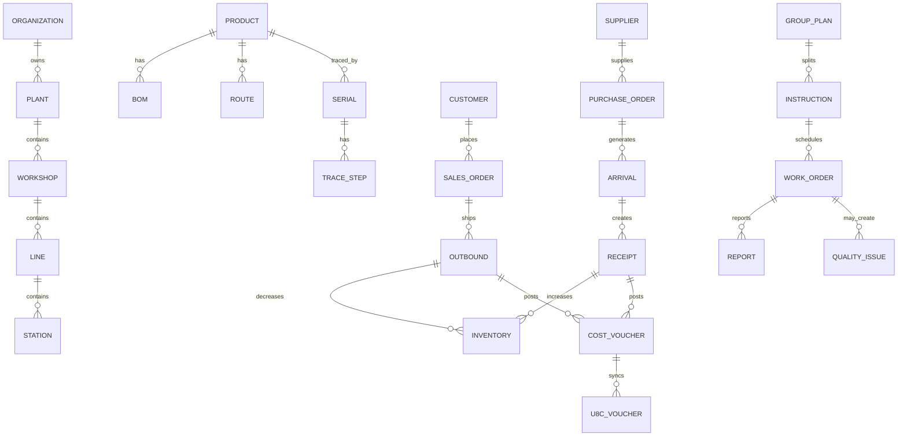

# MES 制造与供应链协同平台 · 架构设计说明书

| 项目 | 内容 |
| --- | --- |
| 文档名称 | 架构设计说明书 |
| 文档版本 | V1.0 |
| 编写日期 | 2026-10-30 |
| 对应原型 | `mes-product-prototype/`（19 个页面） |
| 业务来源 | 《爱达兴高铂尔供应链协同系统业务方案 V1.0-20210603》 + CVMES 制造执行系统 |
| 文档状态 | 可评审 |
| 关联文档 | [需求说明书](./02-requirements.md) |

---

## 1. 文档目的与范围

本文档描述「制造与供应链协同平台」原型的总体架构、分层职责、页面结构、组件体系、数据模型、跨页联动机制、接口契约与部署方式，用于：

1. 让产品、设计与研发对原型的边界、结构和扩展方式形成一致认知；
2. 作为后续替换真实后端、拆分工程、补充权限与实时能力的技术基线；
3. 作为交付验收、二次开发和培训的参考。

范围包括：

- 纯静态原型的技术架构与运行机制；
- 19 个页面、37 个 MESUI 组件能力、24 个领域数据域；
- 演示数据持久化、URL 深链接、全局搜索、操作日志等跨页能力；
- 从静态原型演进到生产系统的架构路径。

不包括：真实数据库设计、真实权限实现、真实 U8C 接口字段映射、部署流水线与运维体系。

---

## 2. 系统概述

### 2.1 业务背景

平台融合两类业务资产：

- **制造执行（MES）**：生产总览、计划、生产制造、生产执行、线边物料、质量、追溯、设备、统计分析和基础数据；
- **供应链协同（SCM）**：采购、销售、库存、存货核算、供应商协同、交付异常与 U8C 财务接口。

业务主线为：

```text
供应商 → 采购 → 到货/入库 → 库存 → 生产制造 → 销售出库 → 存货核算 → U8C
                └────────────── 供应链协同 / 异常与追溯 ──────────────┘
```

### 2.2 建设目标

| 目标 | 可观察结果 |
| --- | --- |
| 一单到底 | 采购订单、到货单、入库单、库存、生产指令、销售订单、出库单、凭证之间可以互相跳转与追溯 |
| 数据联动 | 一个模块的操作能够影响下游模块的数据与状态，并在页面间保留 |
| 角色可读 | 不同角色在同一外壳下快速定位自己的任务、异常与待办 |
| 可交付演示 | 无后端、无构建、离线可打开，可在评审现场完整演示主流程 |
| 可演进 | 页面与组件契约稳定，后续替换接口层即可接入真实后端 |

### 2.3 原型边界

本原型是**可交互高保真原型**，不是生产系统：

- 身份认证为演示登录，无真实鉴权；
- 数据来自 `assets/mock.js`，通过浏览器本地存储跨页保留；
- 写入操作仅修改浏览器内数据，不写数据库、不产生真实财务凭证；
- U8C、ERP、WMS、SCADA 等接口为契约桩（`assets/api.js`），返回模拟结果；
- 生产化所需的并发控制、审批流、权限、审计合规、消息可靠性等在本期不实现。

---

## 3. 架构设计原则

| 原则 | 落地方式 |
| --- | --- |
| 外壳唯一 | 导航、顶栏、搜索、通知只由 `app.js` 生成一次，页面只填充主内容区 |
| 组件复用 | 全部页面通过 `MESUI` 组件渲染，禁止页面自行实现导航、表格、弹窗等基础能力 |
| 数据单一来源 | 所有页面读取同一份 `DB`；写操作回写 `DB` 并持久化 |
| 契约先行 | 页面只依赖 `DB` 字段和 `API` 方法签名，后续替换后端不改页面结构 |
| 渐进增强 | 无构建、无依赖即可运行；持久化、剪贴板等能力失败时降级 |
| 演示可信 | 数据、状态、单号、联动关系保持一致；不出现死链与死按钮 |
| 设计克制 | 工业控制室风格，低装饰、高信息密度、等宽数字、状态色语义统一 |

---

## 4. 总体架构

### 4.1 分层架构

```text
┌──────────────────────────────────────────────────────────────────────┐
│ 表现层：19 个静态页面（HTML）                                          │
│ 生产总览 / 供应链总览 / 车间大屏 / 计划 / 生产制造 / 生产执行 / 线边物料 │
│ 采购 / 销售 / 库存 / 协同 / 存货核算 / 质量 / 追溯 / 设备 / 分析        │
│ 基础数据 / 系统集成 / 登录                                             │
├──────────────────────────────────────────────────────────────────────┤
│ 应用外壳层：assets/app.js                                             │
│ NAV / PAGE_META / 顶栏 / 侧边栏 / 快捷新建 / 通知 / 全局搜索 / 快捷键    │
│ 页面进度条 / 深链接 / 主题外壳 / 响应式导航                             │
├──────────────────────────────────────────────────────────────────────┤
│ 组件层：MESUI（37 个导出能力）                                         │
│ 数据展示：KPI / Table / Bars / VBars / Sparkline / Ring / Gantt        │
│ 业务表达：Flow / StationChain / OpFlow / Kanban / LedBoard / Timeline  │
│ 交互反馈：Modal / Drawer / Confirm / Toast / Empty / 表单校验           │
├──────────────────────────────────────────────────────────────────────┤
│ 设计系统：assets/styles.css                                           │
│ Design Tokens / 布局 / 组件样式 / 响应式 / 动效                        │
├──────────────────────────────────────────────────────────────────────┤
│ 领域数据层：assets/mock.js（24 个数据域）                              │
│ 组织 / 基地 / 计划 / 执行 / 采购 / 销售 / 库存 / 核算 / 质量 / 设备 …   │
├──────────────────────────────────────────────────────────────────────┤
│ 接口契约层：assets/api.js（45 个方法）                                 │
│ Promise + 延迟模拟 + 与 DB 同构的返回结构                              │
├──────────────────────────────────────────────────────────────────────┤
│ 状态与联动层                                                         │
│ localStorage（主）/ window.name（降级）/ URLSearchParams / 操作审计     │
└──────────────────────────────────────────────────────────────────────┘
```

### 4.2 分层职责

| 层 | 文件 | 职责 | 不负责 |
| --- | --- | --- | --- |
| 表现层 | `*.html` | 页面结构、页面级事件、调用 MESUI 渲染、读取 DB | 不实现导航、顶栏、通用表格 |
| 外壳层 | `assets/app.js` | 导航、页面元数据、顶栏、搜索、通知、快捷键、深链接、持久化 | 不实现具体业务规则 |
| 组件层 | `assets/app.js` | 通用 UI 渲染、交互绑定、表格引擎、浮层 | 不保存业务数据 |
| 设计系统 | `assets/styles.css` | tokens、布局、组件外观、动画、响应式 | 不包含业务状态 |
| 数据层 | `assets/mock.js` | 演示数据、状态、单据、组织与主数据 | 不包含渲染逻辑 |
| 契约层 | `assets/api.js` | 模拟接口、异步语义、返回结构 | 不改变页面 DOM |
| 联动层 | `app.js` + 浏览器 | 数据持久化、URL 状态、审计、搜索索引 | 不依赖服务端 |

### 4.3 运行时数据流

```text
首次加载
  mock.js → DB（初始数据）
  app.js  → restoreDemo() → 若有本地快照则覆盖 DB
  页面脚本 → 读取 DB → MESUI 渲染

用户操作（如到货登记）
  表单校验 → 修改 DB（订单/到货/入库/库存）→ MES.save()
  → 刷新当前表格 → Toast 反馈 → 操作日志
  → 页面跳转时 pagehide 再次保存

跨页跳转
  点击链接 → 进度条 → location.href
  目标页 → restoreDemo() → applyQuery(?tab&q&mount)
  → 激活页签 / 过滤表格 / 打开详情

重置
  头像菜单 → 确认 → 清除 localStorage 与 window.name
  → 抑制 pagehide 回写 → reload → 恢复初始 mock 数据
```

---

## 5. 工程结构

### 5.1 目录树

```text
mes-product-prototype/
├── index.html                 # 生产总览（入口）
├── scm.html                   # 供应链总览
├── board.html                 # 车间大屏
├── plan.html                  # 计划管理
├── manufacturing.html         # 生产制造
├── production.html            # 生产执行
├── material.html              # 线边物料
├── purchase.html              # 采购管理
├── sales.html                 # 销售管理
├── inventory.html             # 库存管理
├── collab.html                # 协同管理
├── costing.html               # 存货核算
├── quality.html               # 质量管理
├── trace.html                 # 质量追溯
├── equipment.html             # 设备管理
├── analysis.html              # 统计分析
├── masterdata.html            # 基础数据
├── system.html                # 系统集成
├── login.html                 # 登录
├── assets/
│   ├── styles.css             # 设计系统
│   ├── app.js                 # 外壳 + MESUI + 联动层
│   ├── mock.js                # 领域演示数据
│   └── api.js                 # 接口契约桩
└── docs/
    ├── 01-architecture.md     # 本文档
    └── 02-requirements.md     # 需求说明书
```

### 5.2 文件职责与依赖方向

```text
HTML 页面
  → assets/styles.css
  → assets/mock.js
  → assets/api.js
  → assets/app.js
  → 页面内联脚本（只负责页面逻辑）
```

依赖方向严格单向：页面依赖外壳、组件、数据与接口；外壳与组件不依赖任何具体页面；数据层不依赖渲染层。

### 5.3 页面加载顺序

每个业务页面底部按固定顺序加载：

```html
<script src="assets/mock.js"></script>
<script src="assets/api.js"></script>
<script src="assets/app.js"></script>
<script>/* 页面脚本 */</script>
```

- `app.js` 先注册 `DOMContentLoaded`，页面脚本后注册；
- 外壳与数据恢复先完成，页面脚本再读取 `DB`；
- 页面脚本通过 `MESUI` 渲染，通过 `MES` 使用联动能力；
- 无 `defer`/`async`/构建步骤，保证 `file://` 下顺序稳定。

---

## 6. 应用外壳设计

### 6.1 导航模型

导航是唯一来源 `NAV`，按业务域分组：

| 分组 | 页面 |
| --- | --- |
| 运营中心 | 生产总览、供应链总览、车间大屏 |
| 计划与执行 | 计划管理、生产制造、生产执行、线边物料 |
| 供应链协同 | 采购管理、销售管理、库存管理、协同管理、存货核算 |
| 质量与追溯 | 质量管理、质量追溯 |
| 资源与分析 | 设备管理、统计分析 |
| 平台配置 | 基础数据、系统集成 |

规则：

- 当前页由 `body[data-page]` 标识；
- 导航项 `href` 指向真实页面，激活态由 `page` 匹配；
- 页面标题、面包屑由 `PAGE_META` 统一提供；
- 侧边栏可收起为 64px 图标模式，状态写入 `localStorage`；
- 移动端（≤1080px）切换为抽屉导航。

### 6.2 顶栏能力

| 区域 | 能力 |
| --- | --- |
| 左侧 | 侧边栏收起、移动端菜单、面包屑 |
| 快速新建 | 采购订单、销售订单、生产报工、异常上报、其他入库、调整单 |
| 搜索 | 页面 + 业务对象统一搜索，`Ctrl/Cmd + K` |
| 上下文 | 工作日期、当前班次、实时时钟 |
| 通知 | 未读数、单条已读、全部已读、业务深链 |
| 用户 | 个人与权限、操作日志、快捷键、系统设置、重置演示数据、退出 |
| 反馈 | 页面切换进度条、全局 Toast、加载态 |

### 6.3 路由与深链接协议

本原型为多页应用，页面路由即 HTML 文件；页内状态通过 URL 查询参数表达：

| 参数 | 作用 | 示例 |
| --- | --- | --- |
| `tab` | 激活页签 | `purchase.html?tab=orders` |
| `q` | 表格过滤词 | `purchase.html?tab=orders&q=PO-261025-004` |
| `mount` | 指定目标表格容器 | `quality.html?q=漆面&mount=%23issueTable` |
| `serial` | 追溯序列号 | `trace.html?serial=SN-SD3-261025-0091` |
| `batch` | 追溯批次 | `trace.html?batch=B261025-03` |
| `new` | 打开新建弹窗 | `purchase.html?new=1` |

处理顺序：

1. `init()` 恢复数据并构建外壳；
2. 30ms 后执行 `applyQuery()`：激活页签；
3. 80ms 后对可见表格或指定 `mount` 执行搜索；
4. 页面脚本可在 160~200ms 后处理 `new` 并清理查询参数；
5. 所有页面跳转通过 120ms 延迟 + 顶部进度条，模拟真实加载。

### 6.4 页面生命周期

```text
DOMContentLoaded
  ├─ app.init()
  │   ├─ restoreDemo()
  │   ├─ buildNav()
  │   ├─ buildTopbar()
  │   ├─ bindTabs()
  │   ├─ applyQuery()
  │   └─ 注册 pagehide / visibilitychange / 快捷键 / 链接拦截
  └─ page.init()
      ├─ 读取 DB 数据域
      ├─ MESUI 渲染 KPI、表格、图表、流程
      ├─ 绑定页面交互
      └─ 处理 ?new 与页面级深链
```

---

## 7. 设计系统

### 7.1 Design Tokens

| 类别 | 值 |
| --- | --- |
| 主色 | `#12495F`，深色 `#0F3547` / `#0B2E3D` |
| 强调色 | `#E07B1A` |
| 背景 | `#EDF0F2`，网格纹理 |
| 表面 | `#FFFFFF` / `#F5F7F8` / `#EEF2F4` |
| 边框 | `#D3DBE0` / 强边框 `#B9C5CC` |
| 文本 | `#16242B` / 次文本 `#5B6B74` / 弱文本 `#8A98A0` |
| 成功 | `#1B7F55` + `#E4F3EC` |
| 警告 | `#B8790A` + `#FBF0DC` |
| 危险 | `#B23A2E` + `#F9E7E4` |
| 信息 | `#2A6F97` + `#E5EFF5` |
| 圆角 | 4 / 8 / 12 px |
| 阴影 | 三级 `sh1` / `sh2` / `sh3` |
| 布局 | 侧栏 232px、顶栏 52px、内容最大宽 1560px |
| 字体 | 中文无衬线；数字使用等宽字体；标题使用 DIN 风格显示字体 |

### 7.2 视觉规则

- 工业控制室风格：低饱和背景、细边框、信息密度优先；
- 状态不使用装饰性颜色，只表达业务语义；
- 数字统一等宽、千分位、单位后缀；
- 卡片圆角克制，不使用大面积渐变和阴影；
- 表格头吸顶、行悬停、关键行浅色底；
- 页面进入使用轻量 stagger，避免过度动效。

### 7.3 组件清单（MESUI，37 项）

| 分类 | 组件 |
| --- | --- |
| 基础 | `icon` `tag` `toneOf` `esc` `num` `now` `refs` |
| 数据 | `kpi` `table` `bars` `vbars` `sparkline` `ring` `gantt` `statStrip` `dl` |
| 业务 | `flow` `stationChain` `opFlow` `kanban` `ledBoard` `timeline` |
| 反馈 | `modal` `drawer` `confirm` `toast` `empty` `invalid` |
| 交互 | `bindTabs` `bindSeg` `live` `exportCsv` |
| 外壳 | `nav` `pageMeta` |

### 7.4 页面骨架

| 骨架 | 代表页面 | 结构 |
| --- | --- | --- |
| 驾驶舱 | 生产总览、供应链总览 | KPI + 主流程 + 图表 + 异常 + 明细 |
| 大屏 | 车间大屏 | LED + 深色指标 + 看板 + 异常 |
| 计划流 | 计划管理 | KPI + 流程 + 页签台账 + 甘特 |
| 生产制造 | 生产制造 | KPI + 8 步流程 + 多页签台账 + 进度 |
| 车间执行 | 生产执行 | KPI + 工位链 + 工单 + 报工 + 停机 |
| 台账 | 采购、销售、库存、质量、设备 | KPI + 页签 + 表格 + 弹窗/抽屉 |
| 追溯 | 质量追溯 | 搜索 + 档案 + 时间线 + 谱系 |
| 报表 | 统计分析 | KPI + 图表 + 对比表 |
| 配置 | 基础数据、系统集成 | 层级/参数 + 多页签 + 台账 |

### 7.5 响应式

| 断点 | 行为 |
| --- | --- |
| >1320px | 完整顶栏、搜索输入框、日期/班次 |
| 1081~1320px | 搜索收为图标、隐藏部分上下文 |
| ≤1080px | 侧栏抽屉化、显示菜单按钮 |
| ≤900px | 栅格单列、图表自适应 |
| ≤640px | 隐藏快捷新建与时钟、紧凑化工具栏 |

---

## 8. 页面架构

| 页面 | 路由 | 数据域 | 核心组件 | 主要联动 |
| --- | --- | --- | --- | --- |
| 生产总览 | `index.html` | `overview` `plant` | KPI、Flow、Table、VBars、Timeline | 追溯、生产、质量、设备 |
| 供应链总览 | `scm.html` | `scm` `orgs` `u8c` | KPI、Flow、Table、Sparkline | 采购、销售、库存、协同、U8C |
| 车间大屏 | `board.html` | `board` | LedBoard、Kanban、KPI、Timeline | 生产执行、设备 |
| 计划管理 | `plan.html` | `plans` | OpFlow、Tabs、Gantt、Table | 生产制造、生产执行 |
| 生产制造 | `manufacturing.html` | `manufacturing` | OpFlow、Tabs、Table、Progress | 生产执行、库存、采购 |
| 生产执行 | `production.html` | `production` | StationChain、Table、Modal、Drawer | 质量、追溯、计划 |
| 线边物料 | `material.html` | `material` | 仓库卡、Table、Modal | 库存、采购 |
| 采购管理 | `purchase.html` | `purchase` | Tabs、Table、Modal、Drawer | 协同、库存、存货核算 |
| 销售管理 | `sales.html` | `sales` | Tabs、Table、Modal、Drawer | 库存、生产、U8C |
| 库存管理 | `inventory.html` | `inventory` | 仓库卡、Tabs、Table、Modal | 采购、销售、存货核算 |
| 协同管理 | `collab.html` | `collab` | Tabs、Table、Drawer、Ring | 采购、质量、库存 |
| 存货核算 | `costing.html` | `costing` | OpFlow、Table、VBars、Modal | 库存、U8C |
| 质量管理 | `quality.html` | `quality` | OpFlow、Tabs、Table、Modal | 生产、追溯、协同 |
| 质量追溯 | `trace.html` | `trace` | 搜索、Timeline、Table | 生产、质量、库存 |
| 设备管理 | `equipment.html` | `equipment` | Tabs、Table、Sparkline、Drawer | 生产、质量、看板 |
| 统计分析 | `analysis.html` | `analysis` | KPI、VBars、Bars、Table | 计划、质量、设备 |
| 基础数据 | `masterdata.html` | `masterdata` | 层级、Tabs、Table、Modal | 全部业务模块 |
| 系统集成 | `system.html` | `system` `u8c` | Tabs/Table、Flow、Modal | U8C、接口、日志 |
| 登录 | `login.html` | `plant` `user` | 双栏品牌页、表单 | 进入总览 |

---

## 9. 数据架构

### 9.1 数据域（24 个）

| 域 | 键 | 内容 |
| --- | --- | --- |
| 组织与用户 | `orgs` `plant` `user` | 两家协同组织、基地、班次、产线、当前用户 |
| 消息与审计 | `notifications` `audit` | 通知已读状态、操作日志 |
| 总览 | `overview` | 生产 KPI、作业线、产线负荷、异常、齐套、产品流动 |
| 计划 | `plans` | 月/周/D+3 计划、排程、甘特、预警、规则 |
| 生产制造 | `manufacturing` | 集团计划、指令、BOM、排产、日/周计划、投料、领料、入库、异常 |
| 生产执行 | `production` | 工单、工位链、报工、停机、分时产出 |
| 线边物料 | `material` | 线边库存、拉动单、库房、齐套 |
| 供应链总览 | `scm` | 供应链 KPI、业务总图、待办、交付异常、库存预警 |
| 采购 | `purchase` | 供应商、采购订单、到货、入库、退货、发票、结算、暂估 |
| 销售 | `sales` | 客户、销售订单、出库、发票、收入 |
| 库存 | `inventory` | 仓库、实时库存、出入库、调拨、盘点、预警、库龄 |
| 协同 | `collab` | 交付计划、送货、样品、订单执行、异常、供应商绩效、车间物料 |
| 存货核算 | `costing` | 待记账、凭证、调整单、报表、科目余额、月度收发存 |
| 质量 | `quality` | 检验、质量问题、缺陷、DPU、不合格处置 |
| 追溯 | `trace` | 追溯索引、单台档案、批次档案 |
| 设备 | `equipment` | 设备台账、报警、点检、OEE 趋势 |
| 分析 | `analysis` | 产出趋势、OEE、缺陷 Pareto、产线对比、月度产出 |
| 看板 | `board` | LED、看板、异常、停机 |
| 主数据 | `masterdata` | 层级、产品、BOM、路线、物料、班次、班组 |
| 系统 | `system` `u8c` | 接口、日志、参数、角色、U8C 凭证 |

### 9.2 核心实体关系



### 9.3 状态字典

| 域 | 状态 |
| --- | --- |
| 采购订单 | 已下单、部分到货、已到货、交付逾期 |
| 到货/入库 | 未到货、部分入库、已入库、待审核、已审核 |
| 销售订单 | 待发货、生产中、部分发货、已发货、已开票、已收款 |
| 库存 | 正常、预警、缺料、呆滞 |
| 计划 | 草稿、已排程、待排产、执行中、已锁定、已完成 |
| 生产异常 | 待处理、处理中、已隔离、待评审、已关闭 |
| 设备 | 运行、待机、报警、停机 |
| 不合格 | 待评审、处理中、待放行、已关闭 |
| U8C | 待记账、已记账、已同步、失败 |

状态色调由 `toneOf` 统一映射：绿=完成/正常，黄=进行中/预警，红=异常/失败，蓝=计划/待办，灰=停用/草稿。

### 9.4 数据一致性规则（原型内）

| 规则 | 说明 |
| --- | --- |
| 单据唯一 | 同一原型会话内，固定演示单号不重复生成；重复提交给出提示 |
| 到货联动 | 到货数量回写采购订单 `received` 与状态；合格数量生成入库单并增加库存 |
| 出库联动 | 销售出库扣减成品库存，生成存货凭证与 U8C 存货凭证 |
| 开票联动 | 销售发票状态更新，并生成 U8C 应收单 |
| 报工联动 | 报工增加工单完成数；不良数 > 0 生成质量问题 |
| 判定联动 | 质量问题/不合格品处置更新状态，进入后续放行或关闭 |
| 记账联动 | 凭证由待记账变已记账；批量记账清空待记账队列 |
| 通知联动 | 已读状态随数据快照持久化 |
| 撤销 | 新建采购/销售订单在 Toast 中可撤销，恢复创建前状态 |

> 说明：以上为**演示规则**，真实业务中的审批阈值、容差、编号规则、财务口径需在后端确定。

---

## 10. 跨页联动与状态管理

### 10.1 持久化机制

| 项 | 设计 |
| --- | --- |
| 主存储 | `localStorage`，键 `mes.sc.v25.demo` |
| 降级存储 | `window.name`，前缀 `MESDEMO:`，用于 `file://` 或存储被禁用场景 |
| 版本 | `STORE_VERSION = 2`，版本不一致时忽略旧快照 |
| 保存时机 | 显式 `MES.save()`；`pagehide`；页面隐藏（`visibilitychange`） |
| 恢复时机 | 每页 `init()` 开始，外壳渲染与页面脚本之前 |
| 重置 | 清除两种存储，抑制回写，再刷新 |
| 容量 | 当前演示数据约 80KB，远低于常规配额 |

快照结构：

```json
{
  "version": 2,
  "savedAt": 1790000000000,
  "db": { "plant": {}, "purchase": {}, "inventory": {} }
}
```

恢复后重新建立 `DB.u8c = DB.scm.u8c` 别名，避免 U8C 数据出现双份。

### 10.2 全局搜索

搜索索引在运行时由 `searchObjects(q)` 构建，覆盖：

- 工单（`WO-`）、采购订单（`PO-`）、销售订单（`SO-`）；
- 供应商、库存物料、追溯序列号；
- 质量问题、不合格品、交付异常；
- 集团计划、生产指令、U8C 凭证。

搜索结果按“页面 → 业务对象”分组，点击直达目标页并携带 `tab/q/mount` 参数。

### 10.3 入口联动

| 入口 | 行为 |
| --- | --- |
| KPI 卡片 | 按指标语义跳转到对应模块的明细页 |
| 业务总图节点 | 供应商协同、采购、库存、生产、销售、U8C 直达 |
| 通知 | 已读并跳转到设备报警、库存预警、质量问题、计划 |
| 表格行 | 打开抽屉；部分抽屉底部提供下游模块跳转 |
| 图表 | OEE、缺陷 Pareto 点击下钻 |
| Toast | 成功后提供“查看库存/质量问题/撤销”等动作 |

### 10.4 操作日志

- 成功类 Toast 自动写入 `DB.audit`；
- 日志包含时间、页面、消息；
- 最多保留 80 条，抽屉展示最近 50 条；
- 支持清空；随数据快照持久化；
- 用于演示“操作可追溯”，不作为合规审计实现。

### 10.5 防重复与恢复

- 固定演示单号在创建前检查是否存在；
- 到货、出库、入库、调拨、盘点等重复提交给出提示；
- 新建采购/销售订单支持 Toast 撤销；
- 重置数据可恢复初始演示状态；
- 任何持久化失败均静默降级，不阻断页面使用。

---

## 11. 交互架构

### 11.1 表格引擎

`MESUI.table` 是页面的核心交互组件，支持：

| 能力 | 说明 |
| --- | --- |
| 搜索 | 全字段或指定 `searchKeys`，支持一键清空 / Esc 清空 |
| 排序 | 点击表头，升/降序切换，数字与字符串分别处理 |
| 分页 | 页码、上一页/下一页、每页 5/10/20（含当前自定义值） |
| 选择 | 可选复选框列、全选本页、跨页保留、已选计数 |
| 批量 | 批量导出、自定义批量动作（到货登记、采购申请） |
| 导出 | CSV（带 BOM，Excel 可直接打开） |
| 空态 | 区分“暂无数据”和“无匹配结果” |
| 行交互 | 行点击抽屉；行内按钮独立触发，不冒泡 |
| 状态行 | 逾期/预警/缺货行着色 |

### 11.2 浮层

- `modal`：标题、内容、底部操作、宽版；自动聚焦首个字段；Enter 提交；Esc/遮罩关闭；锁定背景滚动。
- `drawer`：右侧抽屉，用于单据详情、追溯档案、操作日志；支持复制单号。
- `confirm`：危险操作确认；支持说明与风险提示。
- `toast`：成功/警告/危险/信息；带倒计时条与可选动作；成功写入操作日志。

### 11.3 表单

- 统一 `.field` / `.label` / `.input` / `.select` / `.textarea`；
- 必填与范围校验：`MESUI.invalid(input, message)`；
- 错误提示显示在字段下方，输入后自动清除；
- 数量/金额联动（采购、销售、报工）；
- 提交前校验，成功后关闭弹窗并刷新列表；
- 失败/重复/冲突均有明确提示。

### 11.4 键盘

| 快捷键 | 行为 |
| --- | --- |
| `Ctrl/Cmd + K` | 全局搜索 |
| `/` | 聚焦当前页表格搜索 |
| `?` | 快捷键帮助 |
| `Esc` | 关闭最上层弹窗/抽屉，或关闭下拉 |
| `Enter` | 搜索框打开首条；表单内提交 |

### 11.5 页面切换

- 拦截站内 `.html` 链接，显示 2px 顶部进度条；
- 120ms 后导航，兼顾可见反馈与速度；
- 页面加载时再次显示短暂进度；
- `go(page, params)` 供脚本跳转使用；
- 外部链接、`download`、修饰键点击不拦截。

---

## 12. 接口契约

### 12.1 约定

- 所有方法返回 `Promise`；
- 延迟 120~420ms 模拟网络；
- 返回 `{ data }`、`{ list, total }` 或 `{ data, mock: true }`；
- 字段名与 `mock.js` 完全一致；
- 页面只依赖方法名与返回结构，不依赖 `api.js` 内部实现。

### 12.2 方法分组（45 个）

| 分组 | 方法 |
| --- | --- |
| 总览/基地 | `getOverview` `getPlant` `getScm` |
| 计划/制造 | `getPlans` `publishPlan` `getManufacturing` `createInstruction` `createDailyPlan` `submitBomChange` |
| 生产执行 | `getProduction` `submitProductionReport` |
| 质量/追溯 | `getQuality` `judgeNonconformity` `getTraceIndex` `traceBySerial` `traceByBatch` |
| 设备 | `getEquipment` `sendEquipmentCommand` |
| 物料/库存 | `getMaterial` `createPulling` `getInventory` `createStockMovement` `createTransfer` `submitStocktake` |
| 采购 | `getPurchase` `createPurchaseOrder` `auditSupplier` `receivePurchase` |
| 销售 | `getSales` `createSalesOrder` `confirmSalesInvoice` |
| 协同 | `getCollab` `registerShipment` `submitSample` `reportDeliveryException` |
| 核算/U8C | `getCosting` `postCostVoucher` `createCostAdjustment` `getU8C` `syncU8CVoucher` |
| 看板/分析/主数据/系统 | `getBoard` `getAnalysis` `getMasterdata` `getSystem` `retryMessage` |

### 12.3 后端替换策略

1. 保持方法签名与返回结构不变；
2. 将 `api.js` 实现替换为 `fetch`/Axios；
3. 在 `init()` 中把 `restoreDemo()` 切换为服务端会话数据；
4. 移除本地持久化或改为缓存层；
5. 引入统一错误码、鉴权头、分页协议；
6. 页面与组件无需改动。

---

## 13. 非功能设计

| 维度 | 设计 |
| --- | --- |
| 性能 | 纯静态、无第三方库；首屏仅 4 个资源；表格默认分页，图表 SVG/CSS 渲染 |
| 兼容性 | Chrome / Edge 最新版；支持 `file://` 直接打开；无构建依赖 |
| 安全 | 所有数据渲染前 `esc` 转义；CSV 导出过滤 HTML；前端无密钥；演示登录不构成真实鉴权 |
| 可用性 | 空态、错误态、重复提交、无效输入、加载态均有反馈 |
| 可访问性 | 语义按钮、键盘可达、`aria-label`、焦点可见、对比度符合正文可读要求 |
| 可维护性 | 外壳/组件/数据/接口四层解耦；页面无重复导航；命名稳定 |
| 可测试性 | 每页有稳定 `data-page`、挂载点、URL 参数；可做静态检查与端到端脚本 |
| 降级 | 存储不可用时降级为单页内存；剪贴板不可用时提示手动复制 |
| 响应式 | 5 档断点；移动端侧栏抽屉、表格横向滚动 |

---

## 14. 部署与交付

### 14.1 交付形态

- 纯静态目录，无 `node_modules`、无构建产物；
- 入口 `index.html`；
- 资源使用相对路径，可放在任意静态服务器子目录；
- 可直接双击打开，也可通过静态服务器访问。

### 14.2 启动方式

```bash
# 方式一：直接打开
index.html

# 方式二：本地静态服务（推荐，存储行为更稳定）
python -m http.server 8080
# 访问 http://localhost:8080
```

### 14.3 演示账号

- 账号：`admin`
- 密码：`123456`
- 登录页仅做非空校验与演示跳转，不构成真实认证。

### 14.4 交付清单

| 文件 | 说明 |
| --- | --- |
| 19 个 HTML | 业务页面与登录页 |
| `assets/styles.css` | 设计系统 |
| `assets/app.js` | 外壳、组件、联动 |
| `assets/mock.js` | 演示数据 |
| `assets/api.js` | 接口契约 |
| `docs/01-architecture.md` | 架构设计说明书 |
| `docs/02-requirements.md` | 需求说明书 |

---

## 15. 生产化演进路线

### 15.1 目标架构

```text
浏览器（保留现有页面与 MESUI）
  │ HTTPS / REST / SSE
  ▼
BFF / API 网关（鉴权、聚合、限流、审计）
  ├─ 计划与制造服务
  ├─ 采购与销售服务
  ├─ 库存与核算服务
  ├─ 质量与追溯服务
  ├─ 设备与采集服务
  └─ 集成适配层（ERP / U8C / WMS / QMS / SCADA）
        │
        ├─ PostgreSQL / MySQL（业务库）
        ├─ Redis（缓存/会话）
        ├─ 消息队列（领域事件、U8C 凭证重试）
        └─ 对象存储（附件、图片、检验报告）
```

### 15.2 迁移步骤

| 阶段 | 工作 |
| --- | --- |
| 1. 契约冻结 | 保留 `DB` 字段与 `API` 方法，确定分页、错误码、鉴权协议 |
| 2. 接入认证 | 登录改为 OIDC/SSO，页面按角色渲染菜单与按钮 |
| 3. 替换数据 | `api.js` 改为 HTTP；`restoreDemo` 改为会话初始化 |
| 4. 写入闭环 | 采购/销售/库存/质量/核算操作改为服务端事务，返回最新版本号 |
| 5. 实时能力 | 设备、看板、通知使用 SSE/WebSocket |
| 6. 集成 | U8C/ERP/WMS/QMS 适配器，消息幂等、重试、对账 |
| 7. 合规 | 审计、权限、数据保留、电子签名、操作追溯 |

### 15.3 必须新增的生产能力

- 多租户/多组织与数据权限；
- 审批流与金额/数量阈值；
- 并发控制与幂等键；
- 单据编号规则与序列；
- 真实库存事务与成本核算；
- 文件与检验报告存储；
- 监控、告警、日志、备份；
- U8C 字段映射、对账与失败补偿。

---

## 16. 风险与限制

| 风险 | 影响 | 应对 |
| --- | --- | --- |
| 本地存储被清理 | 演示数据丢失 | 头像菜单重置后恢复初始数据 |
| `file://` 存储限制 | 跨页数据可能不保留 | 使用 `window.name` 降级；推荐本地静态服务 |
| 多标签页并发 | 后写覆盖先写 | 生产化引入版本号与冲突提示 |
| 固定演示单号 | 重复提交无法生成新单 | 原型给出重复提示；生产化使用序列号 |
| 静态 KPI | 写操作后汇总指标不自动重算 | 原型保留快照；生产化由服务端聚合 |
| 无真实权限 | 任何人可操作全部功能 | 生产化实现角色与按钮级权限 |
| U8C 为契约桩 | 财务字段与真实系统未对齐 | 联调阶段补充字段映射与对账规则 |

---

## 17. 附录

### 17.1 关键常量

| 常量 | 值 |
| --- | --- |
| 存储键 | `mes.sc.v25.demo` |
| 快照版本 | `2` |
| 窗口名前缀 | `MESDEMO:` |
| 侧栏状态键 | `mes.nav.collapsed` |
| 页面跳转延迟 | `120ms` |
| 搜索延迟 | `30ms` + `80ms` |
| 操作日志上限 | `80` 条 |
| 演示数据规模 | 约 `80KB` |

### 17.2 页面自检项

- 导航与 `body[data-page]` 一致；
- 所有站内链接指向真实页面；
- 所有 `MESUI.table` 挂载点存在；
- 无重复 `id`；
- `data-tab` 与 `data-panel` 一一对应；
- 页面使用的 `DB` 键存在；
- 内联脚本语法通过；
- 关键按钮均有事件绑定。

### 17.3 术语

| 术语 | 定义 |
| --- | --- |
| 四线合一 | 计划线、作业线、监控线、管理线在同一页面呈现 |
| D+3 | 锁定未来 3 天的计划 |
| FTT | 一次合格率 |
| OEE | 综合设备效率 |
| DPU | 单台下线缺陷数 |
| WIP | 在制品 |
| U8C | 用友 U8 Cloud 财务系统 |
| 齐套 | 生产所需物料按 BOM 配齐 |
